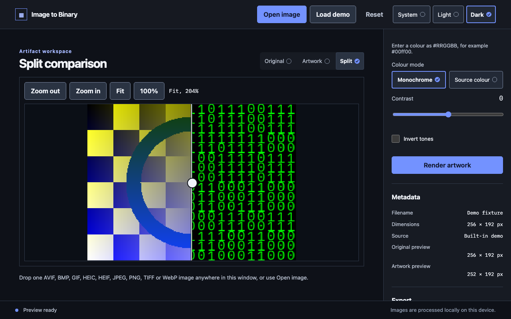

# Image to Binary

Image to Binary turns a picture into a grid of characters: classic 0/1 binary
digits, a custom ASCII ramp, or Unicode block characters. The result is shown
as a live preview and saved as a PNG image or as UTF-8 text.

The project ships two front ends:

- a browser studio (React, TypeScript and a Rust engine compiled to WebAssembly);
- a desktop app (a Tauri 2 shell around the same studio, with image processing in Rust).

The studio replaced the original Python/Tkinter application; see the
[Migration note](#migration-note).



## Contents

- [Quick start](#quick-start)
- [Build and run](#build-and-run)
- [Using the studio](#using-the-studio)
- [Supported formats](#supported-formats)
- [Exports](#exports)
- [Limits](#limits)
- [Architecture](#architecture)
- [Project layout](#project-layout)
- [Privacy](#privacy)
- [Performance](#performance)
- [Browser and desktop differences](#browser-and-desktop-differences)
- [Screenshots](#screenshots)
- [Licences and notices](#licences-and-notices)
- [Troubleshooting](#troubleshooting)
- [Contributing](#contributing)
- [Migration note](#migration-note)

## Quick start

Requirements:

| Tool | Version | Where it is pinned |
| --- | --- | --- |
| Rust | 1.88.0 with `rustfmt`, `clippy` and the `wasm32-unknown-unknown` target | `rust-toolchain.toml` |
| Node.js | 24.15.0 (the frontend requires 24.15.0 or later) | `frontend/.node-version`, `frontend/package.json` |
| wasm-bindgen CLI | 0.2.128 | `crates/wasm/Cargo.toml`, installed by `crates/wasm/scripts/setup.mjs` |

Rust builds use `--locked` so `Cargo.lock` is respected. The setup script
installs `wasm-bindgen-cli` only under `.local/wasm-tools`. Explicit
`CARGO_HOME`, `RUSTUP_HOME` and `PATH` settings take precedence, and `.local`
toolchains are used as fallbacks. Rustup installs the pinned toolchain on first
use unless automatic installs are turned off.

```sh
rustup show                               # installs the pinned Rust toolchain
rustup target add wasm32-unknown-unknown
node crates/wasm/scripts/setup.mjs        # wasm-bindgen-cli 0.2.128, once
cd frontend && npm ci
```

## Build and run

Browser studio, from `frontend/`:

```sh
npm run dev          # builds the WASM package, then serves the studio with Vite
npm run build        # builds the WASM package and writes frontend/dist
npx vite preview --host 127.0.0.1 --port 4173 --strictPort
```

Each of `dev`, `build` and `typecheck` first runs `npm run wasm:build`, which
writes the ignored package to `.local/wasm/pkg`. HEIC and AVIF decoding in the
browser requires a decoder build made by `tools/wasm-codecs/build.sh`. The
frontend build includes the decoder only when `.local/wasm-codecs/dist` exists.

Desktop app, from the repository root:

```sh
cd frontend && npm run build                      # the desktop app embeds frontend/dist
cd ../crates/desktop
cargo build --release --features custom-protocol  # embeds the built frontend
./target/release/image-to-binary-desktop
```

Local desktop packages are built by the scripts in `tools/package/`. They
produce unsigned packages under the ignored `.local/packages/<target>/`:

| Target | Script | Bundles | Host needed |
| --- | --- | --- | --- |
| macOS arm64 | `tools/package/build-macos.sh` | `.app`, `.dmg` | Apple Silicon Mac with `aarch64-apple-darwin` |
| Windows x86_64 | `tools/package/build-windows.sh` | NSIS `-setup.exe`, `.msi` | Windows under Git Bash or MSYS2, `x86_64-pc-windows-msvc` |
| Linux x86_64 | `tools/package/build-linux.sh` | `.deb`, `.AppImage` | x86_64 Linux with WebKitGTK 4.1 development files |

Each script needs the `cargo-tauri` CLI 2.11.5 under `.local/tauri-cli`. Install
it with `cargo install tauri-cli --version =2.11.5 --locked --root .local/tauri-cli`.
The scripts never install targets or toolchains. When the host or a toolchain is
missing they print `UNAVAILABLE: <target>: <reason>` and exit with status 69.

Guards that run before any build:

- Status 78: a signing or notarisation variable is set (for example `APPLE_*`,
  `TAURI_SIGNING_*` or `TAURI_CONFIG`), or a `tauri*.conf.json` overlay or a
  signing or updater setting is present. The message names the variable and
  never prints its value.
- Status 1: the output directory already holds a package. Move or remove it first.

The packages contain the project licence, the font and codec notices and a
generated third-party licence bundle. They exclude the optional native codecs
and the browser HEIC/AVIF decoder (see [Supported formats](#supported-formats)).
Nothing is signed, notarised, uploaded or published.

## Using the studio

1. Open an image with **Open image**, drop one image anywhere in the window, or
   choose **Load demo** for a built-in sample.
2. Pick a render mode: **Classic binary** (0 and 1 split at a threshold),
   **ASCII** (a ramp of up to 64 printable characters, least ink first) or
   **Block** (Unicode block elements with average sampling).
3. Adjust cell size, font size, threshold, colours, colour mode, contrast and
   invert tones. Press **Render artwork** to refresh the artwork preview.
4. Switch the view between **Original**, **Artwork** and **Split** (a draggable
   divider over both images), zoom, pan and fit.
5. Choose **PNG image** or **UTF-8 text** and press **Export**. In the browser,
   then choose **Download**. On desktop, a save dialog opens. **Cancel** stops a
   running job.

The theme choice (System, Light or Dark) is stored in the browser's
`localStorage` under `image-to-binary-theme-choice`. It is the only value the
studio keeps between sessions.

### Keyboard and menu shortcuts

Desktop menus provide these accelerators (`CmdOrCtrl` is Cmd on macOS):

| Action | Shortcut |
| --- | --- |
| Open image | `CmdOrCtrl+O` |
| Export | `CmdOrCtrl+E` |
| Original view | `CmdOrCtrl+1` |
| Artwork view | `CmdOrCtrl+2` |
| Split view | `CmdOrCtrl+3` |
| Render | `CmdOrCtrl+R` |
| Cancel a running job | `Escape` (handled by the page, never while typing in a field) |

In the browser, these actions are buttons. The browser keeps its own shortcuts
for the same key combinations, so the studio does not bind them.

When the comparison canvas has focus:

- `+` or `=` zooms in, `-` or `_` zooms out, `0` fits the image and `1` shows 100%.
- Arrow keys pan the image.
- On the split divider, arrow keys move the split by 1 percent (10 with Shift),
  `PageUp` and `PageDown` by 10 percent, and `Home` and `End` jump to the ends.

## Supported formats

Input (the picker and drop accept these extensions):
`.avif`, `.bmp`, `.gif`, `.heic`, `.heif`, `.jpg`, `.jpeg`, `.png`, `.tif`, `.tiff`, `.webp`.

| Format | Browser | Desktop default package | Desktop with `native-codecs` |
| --- | --- | --- | --- |
| JPEG, PNG, WebP, BMP | yes | yes | yes |
| TIFF (first page), GIF (first frame) | yes | yes | yes |
| HEIC, HEIF (primary image) | only in builds with the decoder | not available | yes |
| AVIF (primary item) | only in builds with the decoder | not available | yes |

Notes:

- Orientation metadata is applied before processing. Sources with 16-bit or
  10-bit samples are normalised to 8 bits.
- Animated PNG, GIF and WebP decode their first frame. Animated WebP with
  alpha-blended frames decodes one level low, a known and accepted limitation.
- HEIC and AVIF use pinned libheif 1.23.7, libde265 1.1.3 and libaom 3.15.3.
  Default desktop packages exclude them because the LGPL-3.0 and HEVC patent
  questions are open (see [Licences and notices](#licences-and-notices)).
- The browser decodes HEIC and AVIF in a lazily created worker that is
  terminated after each decode. PNG and JPEG imports start no decoder.
- Verified coverage, including the tested and untested cells for each format,
  is in [docs/format-coverage.md](docs/format-coverage.md).

## Exports

**PNG** uses the current render settings and writes a classic or average-sampled
image. Desktop exports stream rows to the file as they are encoded. Browser
exports collect the encoded chunks in a Blob before download.

**UTF-8 text** uses the same grid and settings as PNG. The file follows this
contract:

- UTF-8 encoding with no byte order mark.
- Line endings are LF only.
- Every line, including the last, ends with a single LF.
- One output line per grid row; each row has one character per grid cell.

The exports are deterministic. Preview and export share one source grid and one
set of settings, so the text and PNG show the same cells.

Browser downloads are named after the source (for example `png-binary.png`).

## Limits

These values come from the code, and the frontend pins them to the Rust constants.

| Quantity | Limit | Source |
| --- | --- | --- |
| Source pixels (width times height) | 50,000,000 | `crates/adapters/src/session/limits.rs`, `frontend/src/processing/protocol.ts` |
| Encoded input size | 256 MiB | `MAX_ENCODED_BYTES`, same files |
| Decoded RGBA working set per source | 1 GiB | `crates/adapters/src/session/limits.rs`, shared by WASM and desktop |
| Preview and original preview, longest edge | 1600 px, never upscaled | `MAX_PREVIEW_DIMENSION`, `ORIGINAL_PREVIEW_MAX_EDGE` |
| Original-preview output reservation | 1600 × 1600 × 4 bytes | `crates/processing/src/original.rs` |
| PNG and text export output | 256 MiB | `EXPORT_MAX_ENCODED_BYTES` |
| Export chunk size | 1 MiB | `EXPORT_CHUNK_BYTES` |
| Cell size | 5 to 30 px | `crates/core/src/bounds.rs`, `frontend/src/processing/bounds.ts` |
| Font size | 8 to 30 px | same |
| Threshold | 0 to 255 (default 128) | same |
| Contrast | −100 to 100 % | same |
| Custom ramp | 1 to 64 characters, printable ASCII (0x20 to 0x7E) | `crates/core/src/ramp.rs` |
| Source-cell height for average sampling | up to 1024 px | `MAX_SOURCE_CELL_HEIGHT` |
| Work per advance call | 131,072 pixels of stage work | `DEFAULT_PIXEL_BUDGET` |

Where a format header declares its size, a source above the pixel limit is
rejected before pixel decoding, with a readable message. The studio starts with
cell 12 px, font 16 px and threshold 128.

Browser memory is the main practical constraint. Creating a session from a
50 MP RGBA buffer needs about 200 MB in JavaScript and about 200 MB in WASM
memory at the same time. WASM memory grows but never shrinks during a session.

## Architecture

- **Decode once.** A source is decoded to 8-bit RGBA after orientation is applied.
  Native decoders use the `image` crate. The `heif` feature adds libheif.
- **One grid for preview and export.** Sampling produces a deterministic cell grid
  from the source. Classic mode keeps its nearest-neighbour sampling path. The
  newer Block and average presets use average luminance and colour with
  font-aspect correction. Preview and export both render this grid with the same
  settings.
- **Session.** `crates/adapters` owns one source and one job slot. There is one
  active job and at most one newest pending job. Every job carries a generation
  number. Generations must increase, and cancellation and stale generations are
  rejected at call boundaries. Long work is split into bounded `advance` calls
  that yield between WASM calls, so one synchronous call is never interrupted.
- **Browser.** The main thread sends work to a module worker that runs the WASM
  session. Input buffers are transferred, not copied. Preview frames return as
  PNG object URLs. Export chunks are sequence-numbered and assembled into a Blob
  only for the current job.
- **Desktop.** The webview runs the same studio. Processing runs in Rust on a
  worker thread. The page holds opaque ids for one source and one output sink,
  not file paths or handles. Frames cross IPC as raw bytes, not JSON or base64.
  Files are opened from regular files with a 256 MiB cap. Saves write a temporary
  file beside the target, so the destination is not left partly written.

## Project layout

| Path | Contents |
| --- | --- |
| `crates/core` | Validated contracts: settings, bounds, ramps, output kinds, geometry, progress and cancellation |
| `crates/processing` | Decoding (with the optional `heif` feature), normalisation, sampling, glyph rendering and original previews. Examples: `core_bench`, `reference_fixtures`, `browser_matrix_reference`, `heif_reference` |
| `crates/export` | Bounded PNG streaming encoder and export contracts |
| `crates/adapters` | Session lifecycle shared by WASM and desktop, with PNG and text artwork tasks |
| `crates/wasm` | `wasm-bindgen` bindings (`ImageSession`) and the `scripts/` for setup, build and Node tests |
| `crates/desktop` | Tauri 2 shell: native menus, dialogs, files, IPC and worker. Excluded from the root workspace with its own `Cargo.lock` |
| `frontend/` | React and TypeScript studio: `src/processing` (worker, native adapter, HEIF decoder worker), `src/ui` (accessible primitives), `src/export`, state and tests (Vitest) |
| `tools/package/` | Desktop packaging, third-party notice generation (`generate-notices.sh`), guard tests and `verify-macos.sh` |
| `tools/native-codecs/` | Pinned, decode-only native libheif, libde265 and libaom builds for the `heif` feature |
| `tools/wasm-codecs/` | Pinned Emscripten build of the browser HEIF and AVIF decoder |
| `assets/fonts/` | IBM Plex Mono and its OFL notice |
| `docs/` | `PLAN.md` (migration plan), `format-coverage.md`, `images/` (README screenshots) |
| `.github/workflows/` | Continuous integration (checks only) |

Ignored outputs include `.local/`, `target/`, `frontend/dist/`,
`frontend/node_modules/`, `docs/reports/` and the local `AGENTS.md` guidance
file. `docs/images/` is tracked.

## Privacy

The app does not upload images, and the evidence below is what the code and the
network audit show.

- **Browser.** A production-build audit (`docs/reports/playwright/readme-network-audit.mjs`)
  loaded the studio, imported a file, rendered, and exported PNG and text. All
  eight requests went to the app's own origin: the page, its script and style
  sheet, the bundled font, the processing worker, the WASM module and two local
  `blob:` downloads. The source has no `fetch`, `XMLHttpRequest`, `WebSocket`,
  `EventSource` or `sendBeacon` calls in `frontend/src`, and the production
  dependencies are React, React DOM and `@tauri-apps/api`. The studio uses no
  analytics or telemetry library.
- **Storage.** The only persistent value is the theme choice in `localStorage`.
  The studio uses no cookies, IndexedDB or service workers.
- **Desktop.** The webview's Content Security Policy in
  `crates/desktop/tauri.conf.json` allows `connect-src` only to `'self'`, the IPC
  channel and `http://ipc.localhost`. No HTTP client crate appears among the
  dependencies of the workspace crates or the desktop crate, the updater is not
  configured, and the packages disable updater artifacts. This is evidence from
  configuration and dependency lists, not from a traffic capture.

Outside the app, your operating system, browser extensions and the browser
itself control their own network traffic. Those are not covered here.

## Performance

These numbers are measured on one host, with one run per size, sequentially and
without anything else running. They are not a guarantee for other hardware.

Hardware and toolchain: Apple M1 Pro (arm64), 10 CPU cores, 32 GiB memory,
macOS 27.0.1 (build 26A434). rustc and cargo 1.88.0 in release mode. Command:

```sh
cargo run -p image-to-binary-processing --release --locked --example core_bench -- 1
cargo run -p image-to-binary-processing --release --locked --example core_bench -- 12
cargo run -p image-to-binary-processing --release --locked --example core_bench -- 50
```

Times are in milliseconds. The benchmark uses deterministic checker and gradient
fixtures. Peak RSS was measured with `/usr/bin/time -l` around the `cargo run`
command, so it reports the largest process in the tree, which is the benchmark.

| Stage | 1 MP (1000 × 1000) | 12 MP (4000 × 3000) | 50 MP (10000 × 5000) |
| --- | --- | --- | --- |
| Decode | 20.4 | 116.9 | 483.4 |
| Sample grid | 0.1 | 0.2 | 0.7 |
| Render full frame | 11.3 | 92.8 | 385.2 |
| Preview, first render on a new renderer (font load excluded) | 26.3 | 41.8 | 29.4 |
| Preview, warm (same grid, renderer ready) | 22.8 | 41.0 | 29.4 |
| Export PNG, native streaming | 14.8 | 173.6 | 743.3 |
| Export PNG, browser chunks | 10.9 | 131.3 | 551.2 |
| Encoded PNG size | 1.30 MB | 15.6 MB | 65.2 MB |
| Browser chunks | 20 | 239 | 995 |
| Peak RSS | 21.1 MiB | 152.8 MiB | 583.3 MiB |

Targets from [docs/PLAN.md](docs/PLAN.md) are aspirational and were set for
reference hardware that the plan does not name:

- Cached preview under 100 ms at 12 MP: the warm-preview figure above is 41.0 ms
  on this host. This is met for the benchmark's warm render. The benchmark does
  not measure an interactive cache hit in the studio, or the decode and
  sampling time that precede a new preview.
- Cached preview under 250 ms at 50 MP: 29.4 ms on this host, met under the same
  definition.

Preview frames are capped at a 1600 px longest edge, so preview cost follows the
preview grid rather than the source size: the 12 MP source previews at
1600 × 1200 and the wider 50 MP source at 1600 × 800.

Not measured: the studio's end-to-end interaction timing in the browser or
desktop app, other operating systems, other hardware, and variance across runs.

## Browser and desktop differences

| Area | Browser studio | Desktop app |
| --- | --- | --- |
| Open image | `<input type="file">` and drop | Native open dialog (`rfd`) and native file drop |
| Menus and shortcuts | Buttons only; the browser keeps its own shortcuts | Native menu bar with accelerators (see [Keyboard and menu shortcuts](#keyboard-and-menu-shortcuts)) |
| HEIC and AVIF | Lazy decoder worker, only in builds that include it | Excluded from default packages; `native-codecs` enables native decoding |
| Processing | WASM in a module worker | Rust on a native worker thread |
| Export | Blob, then browser download | Streamed PNG or text written atomically to a chosen file |
| Footer and text | "Images are processed locally on this device." | Same text |
| Memory | Bound by the WASM heap | Decoded working set up to 1 GiB |

The desktop app's end-to-end smoke run passes locally on macOS arm64 and in CI
on Linux under Xvfb. CI also builds, lints and tests the desktop crate on Linux,
macOS and Windows; the smoke run itself is not exercised on Windows. Real OS
dialogs and drag and drop are not automated. The screenshots below show the browser studio because native window capture was not
possible in the environment used to prepare them.

## Screenshots

The screenshots show the studio in the browser, at the layouts and themes named
in each caption.

| Image | State |
| --- | --- |
| [desktop-split-dark-1280x800.png](docs/images/desktop-split-dark-1280x800.png) | 1280 × 800, dark theme, Split view, demo image |
| [desktop-artwork-light-1280x800.png](docs/images/desktop-artwork-light-1280x800.png) | 1280 × 800, light theme, Artwork view, classic binary |
| [block-artwork-dark-1280x800.png](docs/images/block-artwork-dark-1280x800.png) | 1280 × 800, dark theme, Artwork view, Block render mode |
| [tablet-artwork-dark-768x1024.png](docs/images/tablet-artwork-dark-768x1024.png) | 768 × 1024, dark theme, Artwork view, inspector below the canvas |
| [phone-split-dark-390x844.png](docs/images/phone-split-dark-390x844.png) | 390 × 844, dark theme, Split view, single column |
| [forced-colors-split-1280x800.png](docs/images/forced-colors-split-1280x800.png) | 1280 × 800, forced-colours mode, Split view |

## Licences and notices

- The project is licensed under the GNU General Public License v3.0 only.
  See [LICENSE](LICENSE). The workspace and desktop crates declare `GPL-3.0-only`.
- [THIRD_PARTY_NOTICES.md](THIRD_PARTY_NOTICES.md) lists the native codecs, their
  pinned versions, licences and sources, and the open questions about LGPL-3.0
  linking and HEVC patents. It also notes the browser decoder assets.
- The bundled IBM Plex Mono font is under the SIL Open Font License. The licence
  is in [assets/fonts/OFL.txt](assets/fonts/OFL.txt), next to the font.
- Codec licence texts are in `tools/native-codecs/licenses/` (libheif, libde265,
  libaom, including its third-party files).
- Packages include a generated bundle of third-party licences. Regenerate it with
  `bash tools/package/generate-notices.sh <rust-target-triple>`. The script reads the
  desktop crate's normal dependencies through `cargo metadata --offline` and the
  production npm tree through `npm ls --offline`. It fails on any licence outside
  its allowlist and on any component it cannot resolve. The output goes to the
  ignored `.local/notices/THIRD_PARTY_LICENSES.txt`.

Keep these notices with any copy of the project, and keep the copyright and
licence text in source files when you edit them.

## Troubleshooting

- **`wasm-bindgen` version or missing tool.** Run `node crates/wasm/scripts/setup.mjs`
  again. It installs the pinned 0.2.128 only under `.local/wasm-tools`.
- **Rust toolchain mismatch.** The repository pins 1.88.0 in `rust-toolchain.toml`.
  Run `rustup show`. If automatic installs are disabled, install the pinned
  toolchain and the `wasm32-unknown-unknown` target yourself.
- **Node version.** Use Node.js 24.15.0 (`frontend/.node-version`). The frontend
  package requires 24.15.0 or later.
- **HEIC or AVIF says it is not available.** The browser build has no decoder
  (see the note in [Build and run](#build-and-run)), or the desktop app is a
  default package. Export the image as JPEG or PNG, or use a build that includes the codecs.
- **A package build reports `UNAVAILABLE` (status 69).** The host, the Rust target or
  the `cargo-tauri` CLI is missing. Install it as described above. The script does not install anything.
- **A package build refuses with status 78.** A signing or updater variable or
  setting is set. Unset it. The packaging scripts never sign.
- **Gatekeeper warns about a local macOS package.** Packages are ad-hoc signed and
  not notarised, so macOS may ask you to confirm before opening them.
- **Desktop shortcut conflicts on Windows or Linux.** Shortcut behaviour on those
  systems is not verified. The webview may claim `Ctrl+R` as a reload before the menu sees it.
- **A very large image takes time.** Decode and render run in a worker, so the
  interface stays responsive. Press `Escape` (desktop or browser) to cancel.

## Contributing

Work follows the numbered subphases in [docs/PLAN.md](docs/PLAN.md). Each subphase
has its own scope, acceptance checks and commit boundary. Keep changes inside the
subphase you are working on.

### Checks

CI runs the same commands. Run them from the repository root unless noted.

```sh
# Rust workspace
cargo fmt --all --check
cargo clippy --workspace --all-targets --locked -- -D warnings
cargo test --workspace --locked
cargo check --workspace --target wasm32-unknown-unknown --locked

# WASM package and Node binding tests
node crates/wasm/scripts/build.mjs
node crates/wasm/scripts/test.mjs

# Core benchmark smoke (1 MP)
cargo run -p image-to-binary-processing --release --locked --example core_bench -- 1

# Frontend, from frontend/
npm ci
npm run typecheck
npm test
npm run format:check
npm run build

# Desktop crate, from crates/desktop/
cargo fmt --all --check
cargo clippy --all-targets --locked -- -D warnings
cargo clippy --all-targets --locked --features smoke -- -D warnings
cargo test --locked
cargo test --locked --features smoke

# Packaging guards and notices
bash tools/package/test/package-guards.sh
bash tools/package/generate-notices.sh aarch64-apple-darwin   # use your host triple
```

CI also asserts that generated outputs are ignored, that the source fixtures,
notices and lockfiles are tracked, and that the worktree is clean after the
builds. Run `git status --porcelain --untracked-files=all` after a build to check
that you have not left build output in tracked paths.

### Browser checks

Browser checks in this repository are local. They use the Chromium build already
downloaded for Playwright, and the project decision of 2026-11-07 limits them to
Chromium. Firefox and WebKit results are reported as not run, never as passed.
Harness scripts live in `docs/reports/playwright/` and write their output to the
ignored `docs/reports/`. Screenshots that are part of the documentation go to the
tracked `docs/images/`.

### Conventions

- Rust code uses checked arithmetic, `Result`-based errors and RAII. Public items
  have Rustdoc (`///`, `//!`) that states invariants and failure contracts.
- TypeScript is strict. Public boundaries carry TSDoc (`/** ... */`).
- Do not add ordinary `//` line comments to product code. Write self-explanatory
  code; keep a comment only for a contract, an invariant, a safety rationale or
  genuinely complex logic. Keep generated comments and licence notices.
- Documentation and comments must not contain commit SHAs of this repository.
- Generated reports go under the ignored `docs/reports/`. Only curated
  documentation assets go under the tracked `docs/images/`.

### What CI does and does not do

The workflows in `.github/workflows/` run formatting, lint, tests, builds, the
WASM package, the desktop checks on Linux, macOS and Windows, package guard tests,
a real-app smoke run under Xvfb on Linux, and a repository hygiene check.
They do not deploy, publish artifacts, sign or notarise releases, or make release decisions.

## Migration note

The Rust, browser and desktop studio replaced the original Python/Tkinter
application. Its sources (`main.py` and `image_processor.py`, with their
Python tests and dependency files) were removed from the working tree once the
replacement was accepted. They remain in this repository's git history, before
the commit that removed them.

The classic binary mode keeps the original semantics: nearest-neighbour
sampling, the floor-grid geometry, a threshold of 128 with dark pixels mapped
to `1`, and green-on-black output. Byte parity with the old Pillow glyph raster is
not claimed; the grid and the 0/1 decisions are the parity target.

